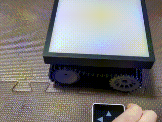

# Overview / 概要

A wireless remote controller for a crawler robot equipped with a LED dot-matrix display.
This application uses the [M5Stack Core2](https://docs.m5stack.com/en/core/core2)'s touch screen to provide a directional control interface, communicating with the robot via [ESP-NOW protocol](https://www.espressif.com/en/solutions/low-power-solutions/esp-now).

\[日本語\]

LEDドットマトリックスディスプレイを搭載したクローラーロボット用の無線リモートコントローラー。
このアプリケーションは、[M5Stack Core2](https://docs.m5stack.com/en/core/core2) のタッチスクリーンに方向制御UIを表示し、[ESP-NOW プロトコル](https://www.espressif.com/en/solutions/low-power-solutions/esp-now) を介してロボットと通信します。



# Hardware Requirements / ハードウェア要件

## Remote Controller Components / リモートコントローラーコンポーネント

- [M5Stack Core2](https://docs.m5stack.com/en/core/core2) : Main controller device with touch screen

\[日本語\]

- [M5Stack Core2](https://docs.m5stack.com/en/core/core2) : タッチスクリーンを備えたメインコントローラーデバイス

## Target Robot (Receiver) / 対象ロボット（受信側）

This remote controller is designed to work with a crawler robot equipped with:
- Microcontroller: [Seeed Studio XIAO ESP32-C6](https://wiki.seeedstudio.com/xiao_esp32c6_getting_started/)
- Motor Driver: [Toshiba TB6612FNG dual motor driver](https://aliexpress.com/item/1005005973846875.html)
- Crawler Kit: [TP101](https://ja.aliexpress.com/item/1005002052435803.html)
- Dot-Matrix Display: [16x16 WS2812B LED dot-matrix panel](https://aliexpress.com/item/4000544584524.html)
- Rechargeable Ni-MH AA Battery x 4 (4.8V)

For robot-side implementation details, see the companion project: [dotmatrix_crawler_robot](https://github.com/cubic9com/dotmatrix_crawler_robot)

\[日本語\]

このリモートコントローラーは、以下のコンポーネントを搭載したクローラーロボットで動作するように設計されています。
- マイクロコントローラー: [Seeed Studio XIAO ESP32-C6](https://wiki.seeedstudio.com/xiao_esp32c6_getting_started/)
- モータードライバー: [Toshiba TB6612FNG デュアルモータードライバー](https://aliexpress.com/item/1005005973846875.html)
- クローラーキット: [TP101](https://ja.aliexpress.com/item/1005002052435803.html)
- ドットマトリックスディスプレイ: [16x16 WS2812B LED ドットマトリックスパネル](https://aliexpress.com/item/4000544584524.html)
- ニッケル水素充電池 x 4 (4.8V)

ロボット側の実装の詳細については、以下の関連プロジェクトをご覧ください。 [dotmatrix_crawler_robot](https://github.com/cubic9com/dotmatrix_crawler_robot)

# Software Requirements / ソフトウェア要件

## Dependencies / 依存ライブラリ

- [M5Unified](https://github.com/m5stack/M5Unified): Arduino / ESP-IDF Library for M5Stack Series

\[日本語\]

- [M5Unified](https://github.com/m5stack/M5Unified): M5Stackシリーズ用Arduino / ESP-IDFライブラリ

# Project Structure / プロジェクト構成

```
dotmatrix_crawler_remote/
├── src/
│   └── main.cpp              # Main program logic
├── include/
│   └── constants.h           # Configuration constants and pin definitions
├── platformio.ini            # PlatformIO project configuration
└── README.md                 # This file
```

\[日本語\]

```
dotmatrix_crawler_remote/
├── src/
│   └── main.cpp              # メインプログラムロジック
├── include/
│   └── constants.h           # 設定
├── platformio.ini            # PlatformIO 設定
└── README.md # このファイル
```

# Related Projects / 関連プロジェクト

- Crawler Robot (Receiver): [dotmatrix_crawler_robot](https://github.com/cubic9com/dotmatrix_crawler_robot) - The crawler robot that receives commands from this controller

\[日本語\]

- クローラーロボット（受信側）: [dotmatrix_crawler_robot](https://github.com/cubic9com/dotmatrix_crawler_robot) - このコントローラーからのコマンドを受信するクローラーロボット

# License / ライセンス

Copyright (C) 2025, cubic9com All rights reserved.

This project is licensed under the MIT license.

See the `LICENSE` file for details.
